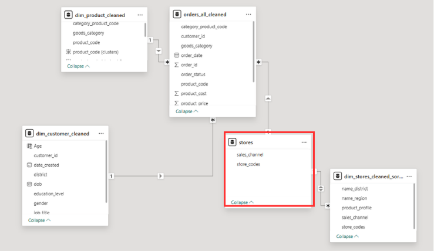
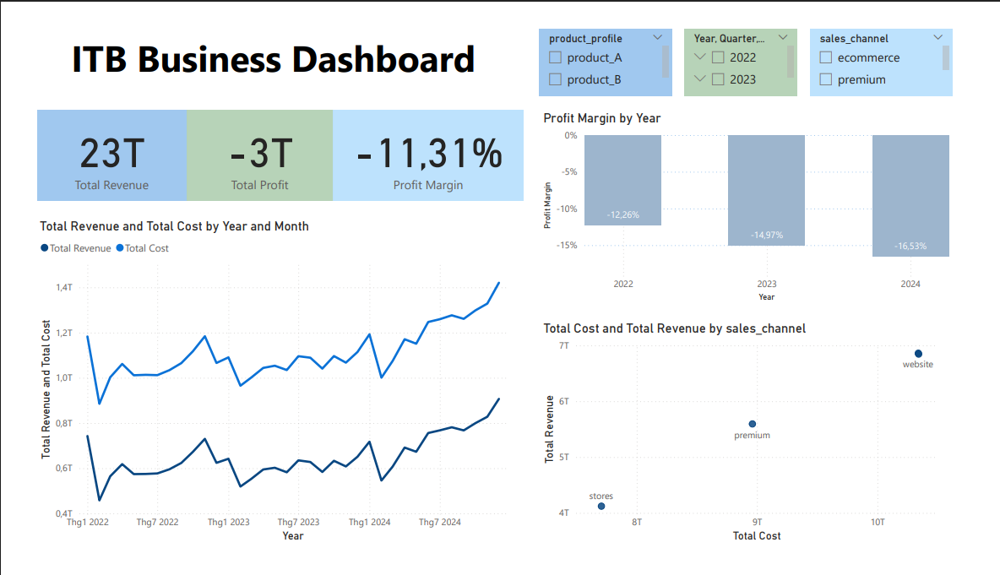

[Tiếng Việt](./README.md) | **English**

# ITB Omnichannel retail business analytics (Power BI - BI9)

Competition project for **BI9 (Round 2)** diagnosing persistent net losses despite growing revenue for omnichannel retailer ITB, followed by cost-structure optimization simulations.

* **My role:** Data cleaning & ETL, Star Schema data modeling, Power BI visualization, and business insights.
* **7-Page dashboard (PDF):** [View Dashboard PDF](./report/Project_BI9_Dashboard.pdf)
* **Full case study deck (27 slides, Vietnamese):** [View Presentation PDF](./report/BI9_Case_Study_Slides.pdf)

---

### 1. Business context & Dataset
* **Business Model:** ITB sells 3 product lines (`product_A` and `product_B` as traffic drivers; `product_C` as the core product) across 4 channels (`Ecommerce`, `Website`, `Stores`, `Premium`). Operational constraints prohibit dropping A/B or shutting down `Stores`.
* **Dataset:** Multi-table operational data from late 2021 to 2024 (~1M rows, 849K customers, ~2M orders).

---

### 2. ETL & Star schema modeling

* **Data preprocessing (Python & Excel):** Removed duplicates, standardized data types, merged order tables, handled invalid IDs (`-43`), and imputed missing values using cross-table logic (e.g., filling missing store regions based on the most frequent customer region).
* **Star schema:** Created a dedicated `stores` bridge/dimension table with unique `store_codes` to enforce clean 1-to-many relationships between the fact table (`orders_all_cleaned`) and dimensions (`dim_customer_cleaned`, `dim_product_cleaned`, `dim_stores_cleaned_sorted`). Configured Product and Date drill-down hierarchies.
* **Dashboard:** Covers `Overview`, `Product Analysis`, `Distribution Analysis`, `Customer Demographics`, `RFM`, `Customer Analysis`, and `Cost Structure` using custom DAX measures.

---

### 3. Key findings
* **Growing revenue, Deepening losses:** Total revenue (2022–2024) reached **23.42T** (~9.66% CAGR), yet cumulative net profit dropped to **-2.65T**, worsening yearly (-901B in 2022 to -1,461B in 2024). All 4 sales channels operated at a loss over the 3-year period.
* **Product mix imbalance:** Contrary to company positioning, `product_A` generated the highest revenue (~11.01T), ahead of `product_C` (~10.30T, ~30.35% CAGR). Two top-selling A-line SKUs (`Product_A_25_2096` and `Product_A_25_2071`) drove high revenue (864B and 665B) but lost ~700B each.
* **Ecommerce fulfillment bottleneck:** `Ecommerce` recorded the lowest delivery success rate (**74.68%**), with 20–25% of orders cancelled or out of stock, compared to `Stores` (94.70%) and `Premium` (98.24%).
* **Cost structure pressure:** `Product Cost` accounted for **77.45%–80.48%** of total cost, while `Variable Cost` (9–10.7%) and `Commission` (5.69–7.21%) further eroded margins, especially in the `Premium` channel.
* **Customer retention risk (RFM & Churn):** Customers aged 25–44 drove nearly 70% of revenue, anchored by `Champions` (144.5K customers, ~9,587B) and `Loyal` (92.5K customers, ~3,715B). However, overall **Churn Rate reached 84%** (712K churned customers) alongside declining new customer acquisition.

---

### 4. Profit optimization scenarios
Simulating 3 cost-reduction levers within operational constraints:
1. Cut Website shipping costs by 50%: **+1.57%** profit improvement.
2. Negotiate partner & Product C commission down to 7%: **+27.2%** profit improvement.
3. Reduce promotion fees from 5% to 2%: **+8.4%** profit improvement.

=> **Combined impact:** Reduces total loss from **-2,648B** to **-1,836B**, representing a **44.22%** net profit improvement.
