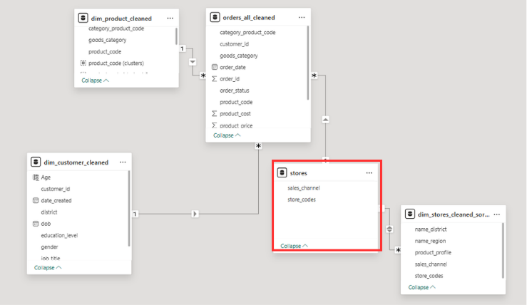
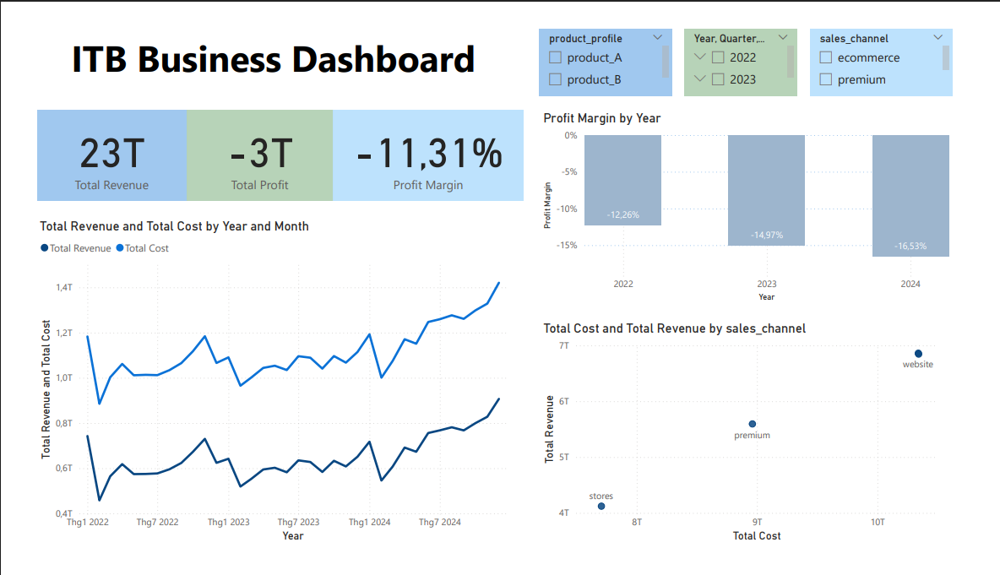

**Tiếng Việt** | [English](./README.en.md)

# Phân tích hiệu quả kinh doanh bán lẻ đa kênh ITB (Power BI - BI9)

Dự án tham gia cuộc thi **BI9 (Round 2)** nhằm chẩn đoán nguyên nhân thua lỗ kéo dài dù doanh thu vẫn tăng trưởng của doanh nghiệp bán lẻ đa kênh ITB, đồng thời xây dựng kịch bản tối ưu cơ cấu chi phí.

* **Vai trò của tôi:** Xử lý & chuẩn hóa dữ liệu (ETL), thiết kế Data Model, trực quan hóa trên Power BI và phân tích insight.
* **Dashboard 7 trang (PDF):** [Xem Dashboard tại đây](./report/Project_BI9_Dashboard.pdf)
* **Slide trình bày chi tiết (27 trang):** [Xem Slides tại đây](./report/BI9_Case_Study_Slides.pdf)

---

### 1. Bối cảnh và Dữ liệu
* **Mô hình kinh doanh:** ITB phân phối 3 nhóm sản phẩm (`product_A`, `product_B` là sản phẩm mồi; `product_C` là sản phẩm chủ lực) qua 4 kênh (`Ecommerce`, `Website`, `Stores`, `Premium`). Ràng buộc thực tế là không thể loại bỏ sản phẩm A/B và không thể đóng cửa kênh `Stores`.
* **Dữ liệu:** Tập dữ liệu đa bảng giai đoạn cuối 2021–2024 (~1 triệu dòng, 849K khách hàng, ~2 triệu đơn hàng).

---

### 2. Quy trình ETL & Thiết kế Data Model

* **Làm sạch dữ liệu (Python & Excel):** Loại bỏ trùng lặp, đồng nhất kiểu dữ liệu, hợp nhất các bảng đơn hàng, xử lý ID lỗi (`-43`) và điền dữ liệu thiếu dựa trên quan hệ chéo giữa các bảng (điền `region` bị null của cửa hàng theo khu vực phổ biến nhất của khách hàng).
* **Mô hình hóa Star Schema (Power BI):** Tách riêng bảng trung gian `stores` chứa `store_codes` duy nhất để đảm bảo quan hệ chuẩn 1-n với bảng Fact `orders_all_cleaned` và các bảng Dimension (`dim_customer_cleaned`, `dim_product_cleaned`, `dim_stores_cleaned_sorted`). Thiết lập Hierarchy theo Sản phẩm (`Profile -> Category -> Goods -> Code`) và Thời gian (`Năm -> Quý -> Tháng -> Ngày`).
* **Dashboard:** `Overview`, `Product Analysis`, `Distribution Analysis`, `Customer Demographics`, `RFM`, `Customer Analysis` và `Cost Structure` với các measure DAX.

---

### 3. Các Insight chính từ dữ liệu
* **Doanh thu tăng nhưng lỗ ngày càng nặng:** Tổng doanh thu giai đoạn 2022-2024 đạt **23.42 nghìn tỷ** (CAGR ~9.66%/năm), nhưng tổng lợi nhuận âm **-2.65 nghìn tỷ** và lỗ nặng dần qua từng năm (-901 tỷ năm 2022 lên -1,461 tỷ năm 2024). Toàn bộ 4 kênh bán đều ghi nhận lợi nhuận âm suốt 3 năm.
* **Lệch pha cơ cấu sản phẩm & SKU đốt tiền:** Trái với định vị ban đầu, `product_A` mới là dòng dẫn đầu doanh thu (~11.01 nghìn tỷ), vượt `product_C` (~10.30 nghìn tỷ, CAGR ~30.35%/năm). Hai mã hàng thuộc nhóm A (`Product_A_25_2096` và `Product_A_25_2071`) tạo doanh thu rất lớn (864 tỷ và 665 tỷ) nhưng mỗi mã đều lỗ khoảng ~700 tỷ.
* **Rủi ro vận hành kênh Ecommerce:** Kênh `Ecommerce` có tỷ lệ giao hàng thành công thấp nhất (**74.68%**), với 20-25% đơn bị hủy trong/sau khi giao hoặc hết hàng. Trong khi đó, `Stores` (94.70%) và `Premium` (98.24%) vận hành rất ổn định.
* **Cơ cấu chi phí mất kiểm soát:** Chi phí sản phẩm (`Product Cost`) chiếm tới **77.45%-80.48%** tổng chi phí. Bên cạnh đó, `Variable Cost` (9-10.7%) và `Commission` (5.69-7.21%) tiếp tục bào mòn biên lợi nhuận, đặc biệt tại kênh `Premium`.
* **Khách hàng & Rủi ro rời bỏ (RFM & Churn):** Nhóm tuổi 25-44 đóng góp gần 70% doanh thu, phân khúc `Champions` (144.5K khách, ~9,587 tỷ) và `Loyal` (92.5K khách, ~3,715 tỷ) là trụ cột. Tuy nhiên, tỷ lệ rời bỏ (`Churn Rate`) lên tới **84%** (712K khách hàng) trong khi lượng khách mới giảm mạnh qua từng năm.

---

### 4. Mô phỏng kịch bản tối ưu lợi nhuận
Thay vì cắt bỏ kênh hay sản phẩm trái với ràng buộc kinh doanh, nhóm mô phỏng kết hợp 3 đòn bẩy chi phí trên Power BI:
1. Giảm 50% chi phí vận chuyển (`shipping cost`) kênh Website: cải thiện lợi nhuận **+1.57%**.
2. Đàm phán giảm tỷ lệ hoa hồng (`partner commission` và hoa hồng cho C) về 7%: cải thiện **+27.2%**.
3. Điều chỉnh phí khuyến mãi (`promotion fee`) từ 5% xuống 2%: cải thiện **+8.4%**.

=> **Tác động tổng hợp:** Giúp giảm lỗ từ **-2,648 tỷ** xuống **-1,836 tỷ**, tương đương cải thiện **44.22%** hiệu quả lợi nhuận.
